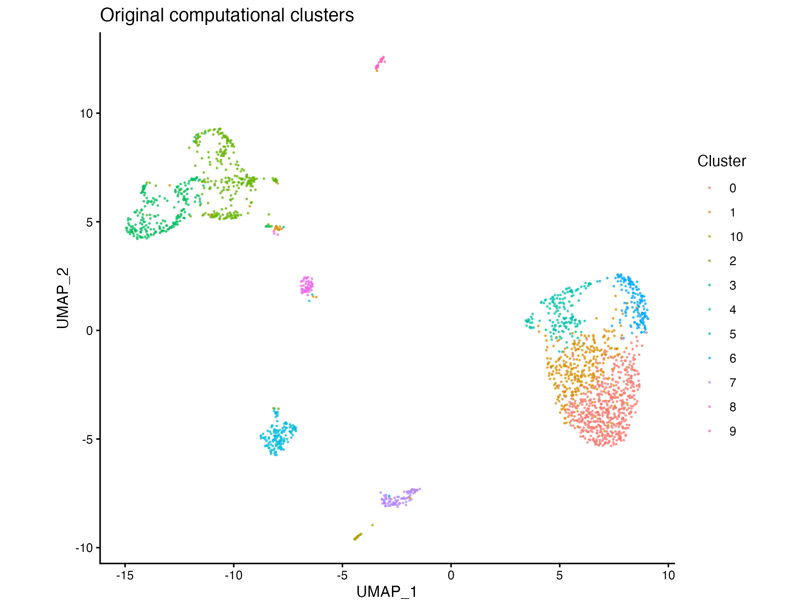
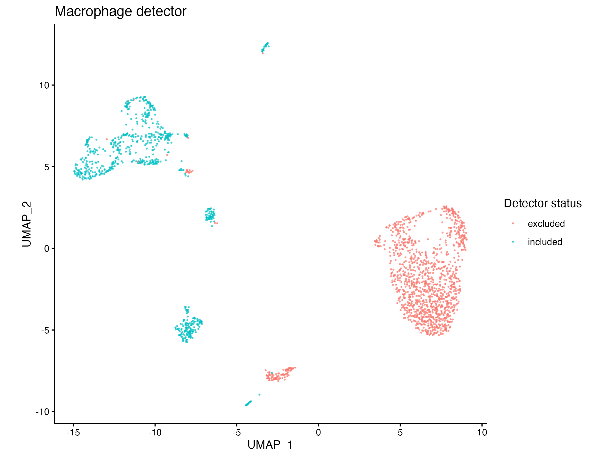
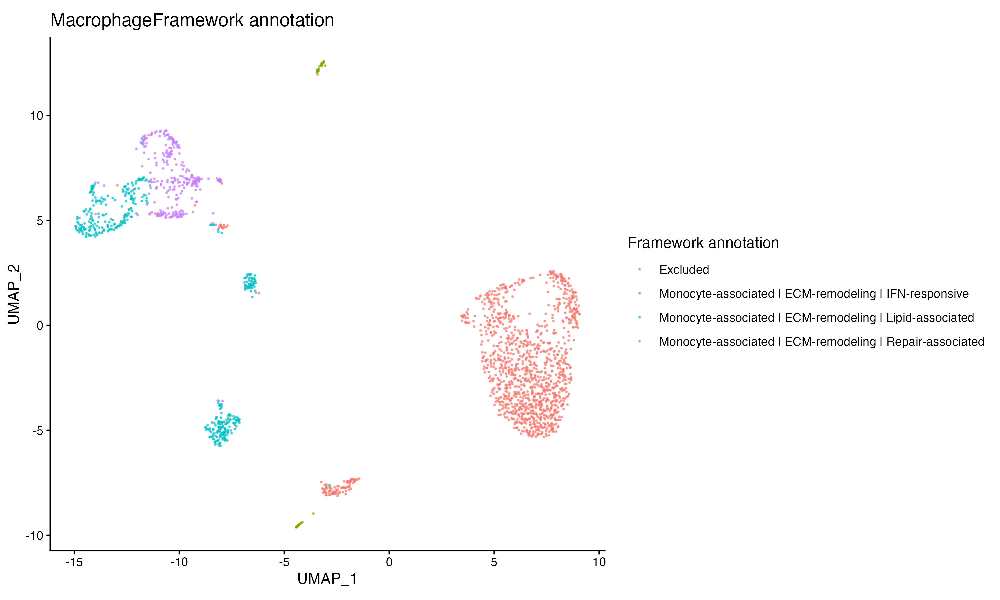
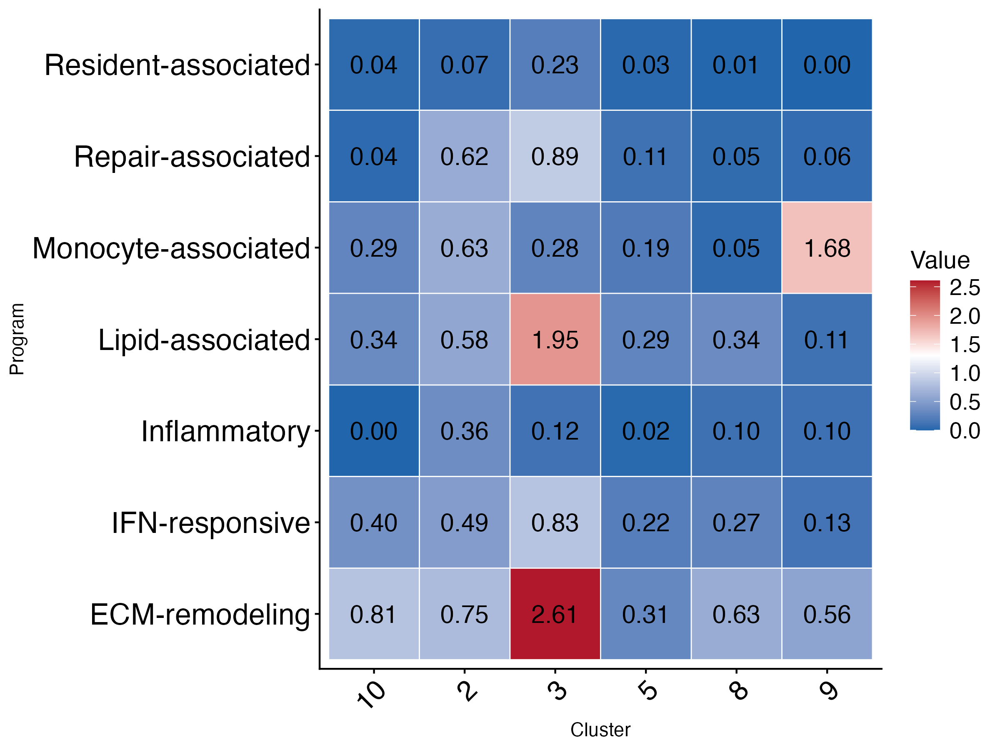
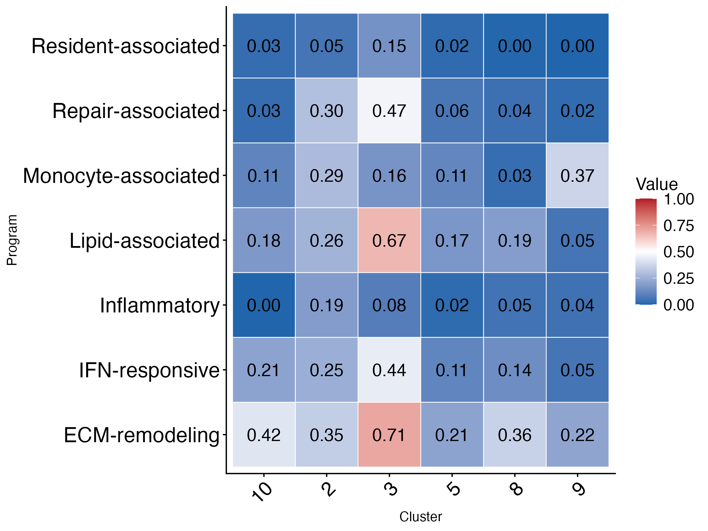
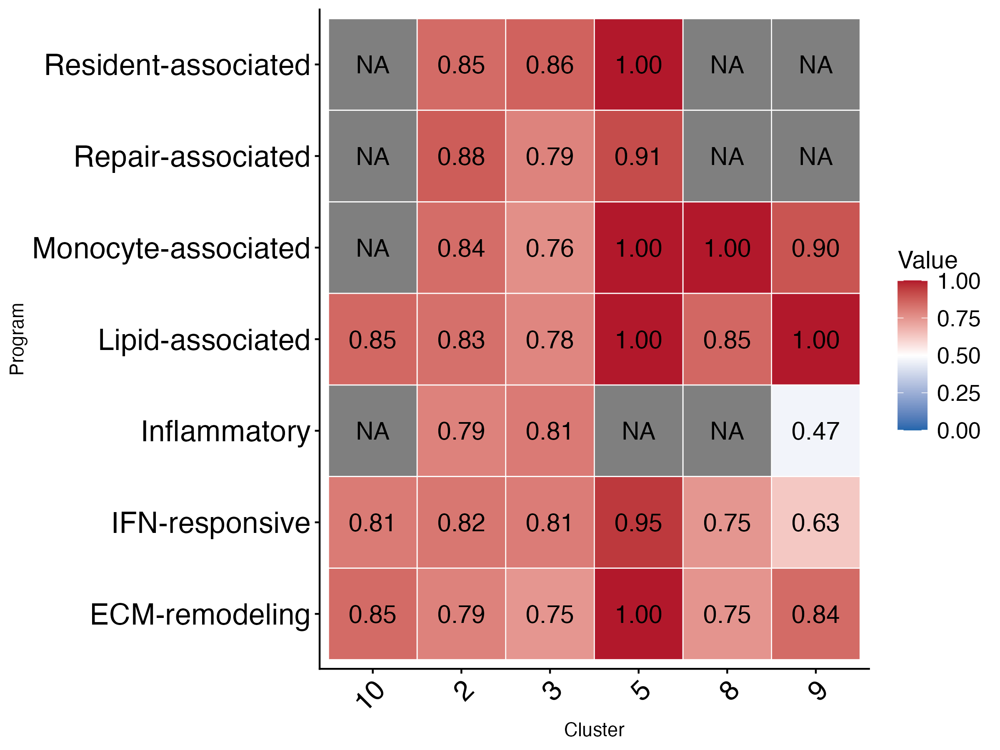
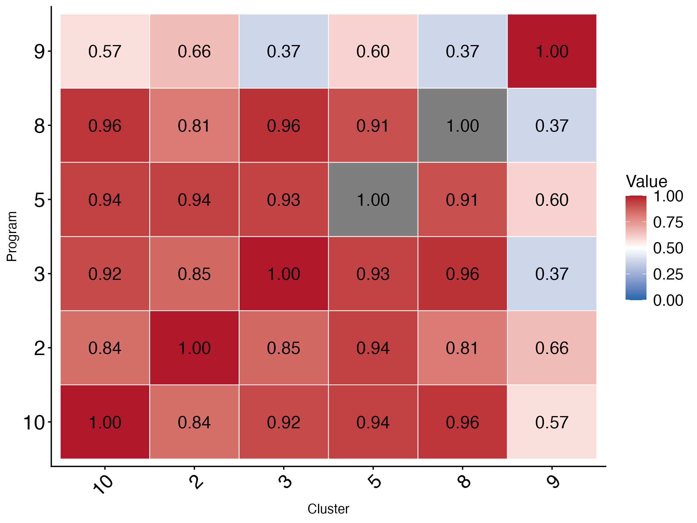

```{r setup, include=FALSE}
knitr::opts_chunk$set(
  collapse = TRUE,
  comment = "#>",
  echo = TRUE
)

result_file <- system.file(
  "extdata",
  "MacrophageFramework_demo_result.rds",
  package = "MacrophageFramework"
)
```

# Introduction

Macrophage identification in single-cell transcriptomic datasets is challenging because lineage-associated features and functional programs may vary independently. MacrophageFramework provides a multidimensional approach that separates macrophage detection from the characterization of biological programs.

This vignette illustrates the workflow using a demonstrative subset of a publicly available human breast cancer dataset, GSE114725. The example highlights macrophage detection, program-level characterization, and similarity between cluster profiles.

The annotations generated by the framework should be interpreted as computational summaries of expression patterns, not as definitive assignments of discrete biological cell types.

# Dataset and preparation

The demonstration dataset is provided as an RDS file containing 2,000 cells and 14,875 genes. It is a reproducible subset of the original dataset and is intended to illustrate the workflow rather than provide an exhaustive characterization of the tumour microenvironment.

The original dataset is available through the Gene Expression Omnibus under accession GSE114725.

```{r load-data}
demo_file <- system.file(
  "extdata",
  "GSE114725_demo.rds",
  package = "MacrophageFramework"
)

demo_seurat <- readRDS(demo_file)

result_file <- system.file(
  "extdata",
  "MacrophageFramework_demo_result.rds",
  package = "MacrophageFramework"
)

demo_result <- readRDS(result_file)

dim(demo_seurat)
names(demo_result)
```

# Clustering and embedding

The following code illustrates a standard preprocessing workflow. It is included for reproducibility but is not evaluated when building the vignette.

```{r preprocessing, eval=FALSE}
set.seed(1982)

demo_seurat <- NormalizeData(demo_seurat, verbose = FALSE)

demo_seurat <- FindVariableFeatures(
  demo_seurat,
  selection.method = "vst",
  nfeatures = 2000,
  verbose = FALSE
)

demo_seurat <- ScaleData(
  demo_seurat,
  features = VariableFeatures(demo_seurat),
  verbose = FALSE
)

demo_seurat <- RunPCA(
  demo_seurat,
  npcs = 30,
  verbose = FALSE
)

demo_seurat <- FindNeighbors(
  demo_seurat,
  dims = 1:20,
  verbose = FALSE
)

demo_seurat <- FindClusters(
  demo_seurat,
  resolution = 0.5,
  random.seed = 1982,
  verbose = FALSE
)

demo_seurat <- RunUMAP(
  demo_seurat,
  dims = 1:20,
  seed.use = 1982,
  verbose = FALSE
)
```

# Running MacrophageFramework

MacrophageFramework analyses the Seurat object and returns macrophage detection results, program-level scores, coverage, coherence, cluster profiles, and profile similarity.

```{r framework-analysis, eval=FALSE}
demo_result <- analyze_macrophage_profile(
  object = demo_seurat,
  assay = "RNA",
  layer = "counts",
  reduction = "umap",
  detect_macrophages = TRUE,
  min_core_score = 0.1,
  species = "Human",
  save_outputs = TRUE,
  output_dir = "MacrophageFramework_demo_output"
)
```

# Results
```{r load-results, include=FALSE}
result_file <- system.file(
  "extdata",
  "MacrophageFramework_demo_result.rds",
  package = "MacrophageFramework"
)

demo_result <- readRDS(result_file)
```
## Original computational clusters

The original clustering provides the computational context for the subsequent macrophage detection and characterization steps.



## Macrophage detection

The detector evaluates macrophage-associated features to distinguish candidate macrophage populations from other clusters. Detection should be interpreted as a computational screening step, not as a substitute for independent validation.



## Multidimensional framework annotation

The framework combines lineage-associated information with functional program profiles. This allows candidate populations to be described through combinations of programs rather than a single binary activation category.



## Program intensity

Program intensity summarizes the relative expression-based signal associated with each biological program across clusters.



## Program coverage

Coverage complements intensity by describing the extent to which program-associated genes are detected. Similar intensity values may therefore occur with different levels of gene detection.



## Program coherence

Coherence provides an additional dimension for evaluating the consistency of the expression pattern associated with a program. It should be interpreted alongside intensity and coverage rather than as an independent biological validation.



## Similarity between cluster profiles

Profile similarity compares multidimensional program profiles between clusters. Similarity can highlight related expression patterns without requiring the clusters to be assigned identical biological identities.



# Interpretation and limitations

This example illustrates how macrophage detection and multidimensional program characterization can be integrated into a single workflow.

Several limitations should be considered:

- The dataset is a subset of the original GSE114725 dataset and may underrepresent rare populations.
- Results depend on preprocessing, clustering, gene detection, and framework parameters.
- Program annotations describe expression patterns and should not be interpreted as definitive cell identities or causal mechanisms.
- Independent biological validation remains necessary.

# Reproducibility

The example uses a fixed random seed for the demonstrative preprocessing workflow. The RDS dataset and the figures are intended to make the vignette lightweight and reproducible.

For a complete analysis of the original dataset, users should retrieve GSE114725, document all preprocessing decisions, and rerun the framework on the full dataset.

# Session information

```{r session-info}
sessionInfo()
```
